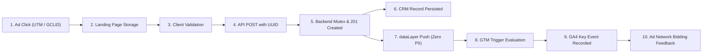
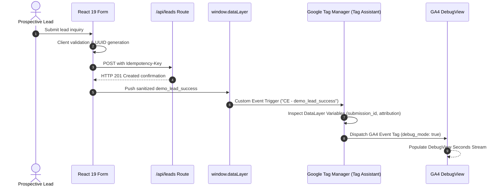

# Tracking Demos

[](file:///C:/Users/Ranji/code-base/RL-Demo/demo/test-results/verification-matrix.md)
[](file:///C:/Users/Ranji/code-base/RL-Demo/docs/CONTRACTS.md)
[](file:///C:/Users/Ranji/code-base/RL-Demo/demo/scripts/scan-pii.mjs)

This repository contains production-grade demonstration implementations, debugging scenarios, and validation workflows for:

- **Google Tag Manager (GTM)** (Web container architecture, trigger filters, DataLayer variables)
- **Google Analytics 4 (GA4)** (Recommended events, parameter schema hygiene, DebugView validation)
- **Google Ads Conversion Tracking** (Click-to-conversion integrity, offline click attribution, deduplication)
- **Meta Pixel & Conversions API** (Event schemas, client vs. server deduplication patterns)
- **Enhanced Conversions & Consent Mode v2** (Default denials, consent updates, un-hashed PII prevention)
- **Lead & Form Submission Tracking** (Attribution persistence, validation decoupling, honeypots)
- **Tracking QA & Audits** (Automated matrix assertions, regression testbeds)

> **Core Audit Principle**: *A form that successfully displays a thank-you message does not mean its conversion data is trustworthy.*

---

## 1. What This Workspace Proves

Marketing budgets and automated bidding algorithms (Target CPA, Maximize Conversions, Target ROAS) depend on clean signals. In typical corporate setups, tracking bugs silently inflate cost per acquisition or train algorithms on junk clicks.

This workspace provides an inspectable **12-step conversion integrity chain**:



---

## 2. Included Scenarios & Failure Mode Demonstrations

Every scenario is implemented as a real, reproducible code path:

| Scenario | Route | What Happens | Real-World Impact | Verification Layer |
|---|---|---|---|---|
| **Baseline (Healthy)** | `/scenario/baseline` | 1 form submission &rarr; 1 CRM record &rarr; 1 dataLayer event with 7 approved keys | Clean signals for Smart Bidding algorithms | Confirmed Locally & Automated |
| **Defect 1: False Conversion** | `/scenario/defect-1` | Click listener fires before validation; form validation fails | Bidding algorithms learn to target users who bounce or submit invalid forms | Confirmed Locally (`defect-1.spec.ts`) |
| **Defect 2: Duplicate Conversions** | `/scenario/defect-2` | Legacy script on click + modern handler post-submission both fire with same `submission_id` | Conversion numbers doubled; reported CPA artificially halved | Confirmed Locally (`defect-2.spec.ts`) |
| **Defect 3: Missing Conversion** | `/scenario/defect-3` | Typo in event constant (`demo_lead_sucess`) prevents GTM trigger match | Zero conversions reported; high-performing campaigns appear completely dead | Confirmed Locally (`defect-3.spec.ts`) |
| **Defect 4: Schema Drift** | `/scenario/defect-4` | DataLayer parameter `form_id` dropped; `lead_type` hardcoded to `'contact'` | Custom dimensions show `(not set)`; value-based bidding broken | Confirmed Locally (`defect-4.spec.ts`) |
| **Defect 5: SPA Attribution Loss** | `/scenario/defect-5` | Step 2 navigation drops query string; submit handler reads `location.search` | 70%+ of paid search leads misattributed to "Direct / None" in CRM | Confirmed Locally (`defect-5.spec.ts`) |
| **Defect 6: CRM Webhook Mismapping** | `/scenario/defect-6` | Server mapper drops `utm_campaign` and puts `utm_source` into detail field | Deceptive checkmark in GA4, but sales pipeline cannot credit ad spend | Confirmed Locally (`defect-6.spec.ts`) |

---

## 3. Architecture & Tracking Implementation

### 3.1 Google Consent Mode v2 Default Injection
Before any analytics or container script runs, the application enforces default consent denial:

```html
<script id="google-consent-mode-init">
  window.dataLayer = window.dataLayer || [];
  function gtag(){dataLayer.push(arguments);}
  gtag('consent', 'default', {
    'ad_storage': 'denied',
    'analytics_storage': 'denied',
    'ad_user_data': 'denied',
    'ad_personalization': 'denied',
    'wait_for_update': 500
  });
</script>
```

### 3.2 Enterprise Zero-PII DataLayer Contract
Conversion events pass **only** validated technical metadata—never names, phone numbers, or email addresses:

```json
{
  "event": "demo_lead_success",
  "form_id": "lead_audit_demo",
  "lead_type": "agency_audit_inquiry",
  "scenario": "baseline",
  "submission_id": "c7a829e0-81f3-4d43-9821-2a62886f4a10",
  "attribution_status": "present",
  "debug_mode": true
}
```

---

## 4. GTM & GA4 Validation Workflows



### Validation Checklist in Google Tag Assistant:
1. **Container Workspace**: Test in an isolated workspace (e.g., `ResponseLock Demo Validation`).
2. **Consent State**: Confirm `analytics_storage` transitions from `denied` to `granted` upon cookie acceptance.
3. **Trigger Evaluation**: Verify trigger `CE - demo_lead_success` evaluates to `true` **only** after HTTP 201.
4. **Parameter Inspection**: Verify `submission_id`, `form_id`, and `lead_type` resolve to clean values without `(not set)`.

---

## 5. Verification Framework & Test Suite

The workspace includes a complete regression suite ensuring all defects remain strictly reproducible:

```bash
# 1. Start the local demonstration environment
npm run dev

# 2. Run unit and concurrency stress tests (135 tests)
npm run test:unit

# 3. Run Playwright E2E scenario suites & accessibility tests (32 tests)
npm run test:e2e

# 4. Run automated PII and credential scan
npm run scan:pii

# 5. Full end-to-end verification pipeline
npm run verify
```

### Automated Matrix Provenance:
| Scenario | Success UI | CRM Rows | Expected Events | Result |
|---|:---:|:---:|:---:|---|
| Baseline valid | 1 | 1 | 1 | Correct |
| Baseline invalid | 0 | 0 | 0 | Correct rejection |
| Defect 1 invalid | 0 | 0 | 1 | False conversion |
| Defect 2 valid | 1 | 1 | 2 | Duplicate conversion |
| Defect 3 valid | 1 | 1 | 0 | Missing conversion |
| Defect 4 valid | 1 | 1 | 1 | Parameter defect |
| Defect 5 valid | 1 | 1 | 1 | Attribution lost |
| Defect 6 valid | 1 | 1 | 1 | CRM mapping incomplete |

---

## 6. Project & Audit Documentation

For operational guides and sample deliverables, refer to:

- [**Instructions & Workspace Guide**](file:///C:/Users/Ranji/code-base/RL-Demo/instructions.md) — Setup and execution instructions
- [**Final Manual Verification Runbook**](file:///C:/Users/Ranji/code-base/RL-Demo/docs/final-manual-verification-runbook.md) — Step-by-step manual QA guide for Tag Assistant & DebugView
- [**Defect Catalog**](file:///C:/Users/Ranji/code-base/RL-Demo/docs/defect-catalog.md) — Technical breakdowns and real-world analogues
- [**Sample Audit Report**](file:///C:/Users/Ranji/code-base/RL-Demo/audit-template/sample-audit-report.md) — Complete 7-part diagnostic audit deliverable
- [**Redacted Sample Report**](file:///C:/Users/Ranji/code-base/RL-Demo/audit-template/redacted-sample.md) — Executive two-page audit sample
- [**GTM Setup & Container Export**](file:///C:/Users/Ranji/code-base/RL-Demo/gtm/responselock-demo-container.json) — Dedicated non-production test container JSON

---

## 7. Epistemic Boundaries & Ethics

- **Zero Fabricated Client Work**: All case studies, companies (e.g. Apex Horizon Technologies), and domains use RFC 2606 reserved namespaces (`@example.com`, `.example.com`).
- **No Production Account Contamination**: No live Google Ads accounts are triggered; Google Ads attribution is evaluated conceptually to prevent false conversion signals.
- **Privacy-First**: Fictional data only (`+1-555-0100` to `+1-555-0199`).
